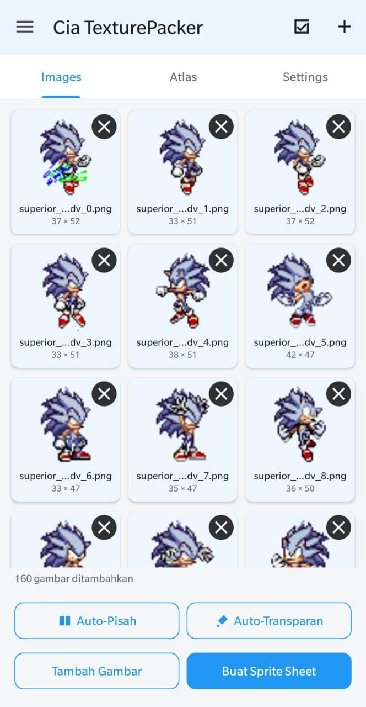
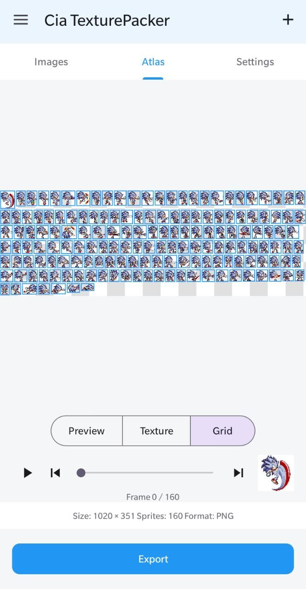
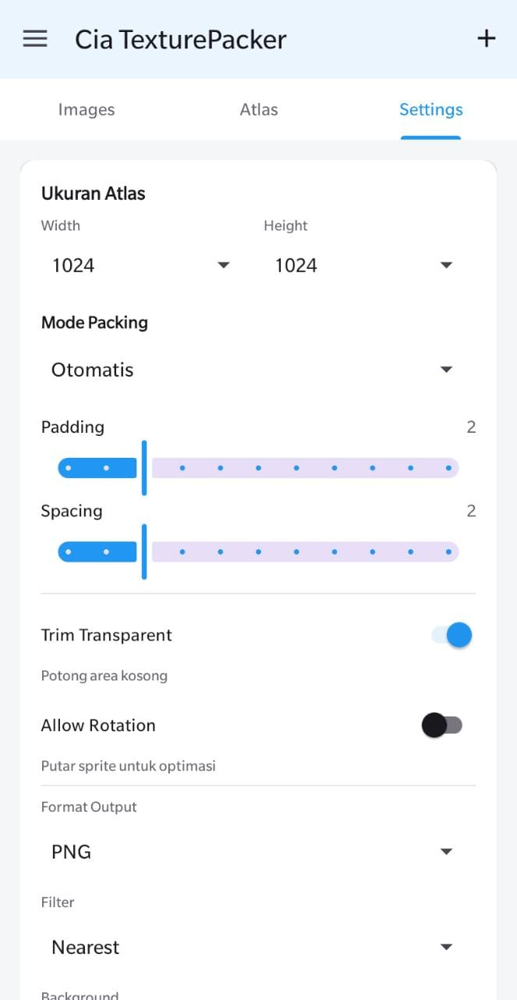
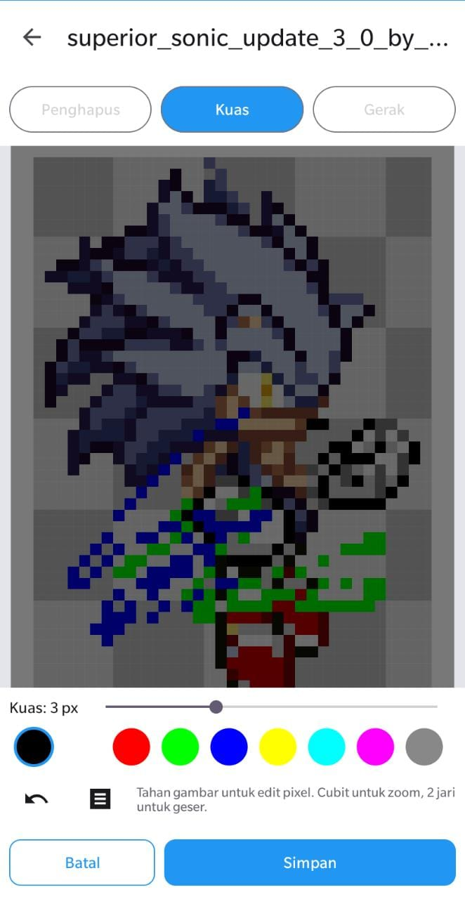
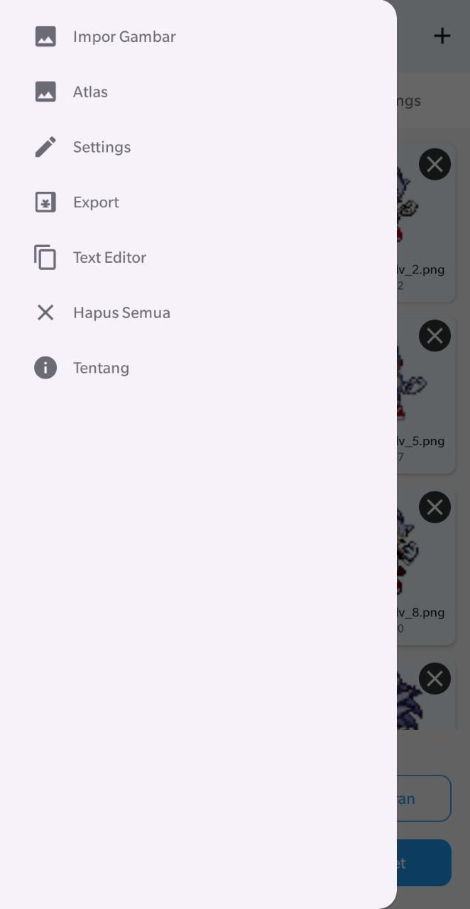

# Cia TexturePacker

Aplikasi Android untuk menggabungkan banyak gambar sprite menjadi satu **sprite sheet / texture atlas**, lengkap dengan pixel editor built-in. Dibuat untuk kebutuhan game development — packing sprite jadi cepat dan rapi.

## Fitur

### 📥 Impor Gambar
- Impor banyak gambar sekaligus dari file picker
- Preview thumbnail per sprite dengan ukuran aslinya



### ✂️ Auto-Pisah Sprite
Otomatis memisahkan gambar yang berisi beberapa sprite (connected-components pada alpha channel). Contoh: `Tower1.png` → `Tower1_0.png`, `Tower1_1.png`.

### 🪄 Auto-Transparan
Mendeteksi warna background dari empat sudut gambar dan membuatnya transparan (tolerance default 32).

### 🗺️ Atlas / Sprite Sheet
- Mode packing **Otomatis (Shelf)** dan **Grid** (ukuran sel 32/64/128/256)
- Preview checkerboard + garis grid
- Mode tampilan: Preview / Texture / Grid
- Animasi preview frame-by-frame



### ⚙️ Pengaturan Packing
- Ukuran atlas (width × height)
- Padding & spacing antar sprite
- Trim transparent (potong area kosong)
- Format output: PNG



### 🎨 Pixel Editor
Long-press thumbnail untuk edit pixel per sprite:
- Tool: Penghapus, Kuas, Gerak (pan)
- Ukuran brush 1/3/5/9 px, 9 warna
- Undo (20 langkah), zoom 1–64x
- Grid overlay + checkerboard background



### 📤 Export
- PNG sprite sheet
- Data format: **JSON** (Phaser/PixiJS), **XML**, **plist** (Cocos2d), **TXT**
- Lihat & edit data langsung di aplikasi (Text Editor dengan syntax highlighting)

### 🗂️ Menu
Akses cepat: Impor Gambar, Atlas, Settings, Export, Text Editor, Hapus Semua, Tentang.



## Download APK

APK terbaru tersedia via Google Drive (link dibagikan terpisah).

## Build

```bash
export JAVA_HOME=/home/hatch/java/jdk-17
export GRADLE_USER_HOME=/home/hatch/.gradle
export JAVA_TOOL_OPTIONS="-Djava.net.preferIPv4Stack=true"
~/gradle-dist/gradle-8.9/bin/gradle :app:assembleDebug --offline
```

- compileSdk 35, targetSdk 34, minSdk 26
- APK: `app/build/outputs/apk/debug/app-debug.apk`

## Struktur Project

```
app/src/main/java/com/cia/texturepacker/
├── MainActivity.kt          # Activity utama + drawer
├── ImagesFragment.kt        # Tab Images (grid sprite)
├── AtlasFragment.kt         # Tab Atlas (preview sprite sheet)
├── SettingsFragment.kt      # Tab Settings
├── PixelEditorActivity.kt   # Pixel editor
├── PixelCanvasView.kt       # Custom view canvas pixel
├── PackViewModel.kt         # State + logic packing
├── SpritePacker.kt          # Algoritma packing (shelf & grid)
├── BackgroundRemover.kt     # Auto-transparan
├── SpriteSplitter.kt        # Auto-pisah sprite
├── DataEditorActivity.kt    # Text editor data atlas
└── ...
```

## Lisensi

Project pribadi — all rights reserved.
